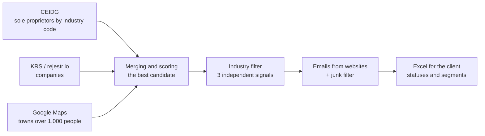

# A database of companies from all over Poland with email contacts: case study

**B2B lead generation: business registries + Google Maps + company websites → a ready-to-use sales database.**
Python · Playwright · openpyxl · CEIDG · KRS / rejestr.io · 2captcha

> A Useme freelance project (2026): the client wanted **every jewellery business in Poland** with contact details, including email.
> This repository shows how I did it, with the code used in the project (without client data and without API keys).

---

## Results

| | |
|---|---|
| Companies in the final database (sole proprietorships + companies) | **~6,700** |
| Google Maps listings processed | **5,774** |
| Company websites scanned | **~3,300** |
| Domains an email was found on | **931** |
| Websites blocking automation (403/404, bot protection), marked with a separate status | **392** |
| Success rate: websites that yielded an email | **~70%** |
| Delivery time | **3-4 days** |

## My own database of Polish companies

Day to day I work on my own, privately built database:

- **the full CEIDG registry**: every sole proprietorship in Poland,
- **a database of companies from the KRS registry** (via rejestr.io),
- **continuous updates**: new registrations, status changes, suspensions and closures,
- **contact details** added from company websites and Google Business profiles, deduplicated by tax ID (NIP).

Thanks to this, a project like "every company in industry X in Poland" starts with a database query (industry code, region, founding date, legal form), and scraping only fills in the missing contacts. The database is private and not part of this repository.

## The problem

No single source has everything:

- **Google Maps** has phone numbers, websites and categories, but misses businesses without a listing and does not say whether it is a sole proprietorship or a company.
- **CEIDG** (sole proprietorships) and **KRS / rejestr.io** (companies) contain every registered business with its tax ID, but some exist only on paper or are registered under an industry code that does not match what they actually do.
- **Emails** are not in Maps at all, and company websites are full of junk addresses from templates (`mail@domain.com`), addresses of the agencies that built the site, and technical addresses.

## How I did it



1. **Collecting businesses from three sources.**
   Sole proprietorships from CEIDG by the industry's codes (jewellery manufacturing and wholesale, retail, watch repair), companies from KRS / rejestr.io, and a Google Maps search for the industry in every Polish town with more than 1,000 inhabitants. This way the database also includes businesses invisible on Google and businesses visible on Google but registered under a different code.

2. **Merging records**: [`rejestry_i_google/polacz_gmaps_z_ceidg.py`](rejestry_i_google/polacz_gmaps_z_ceidg.py).
   The key is the "business name + address" string used for the search. When Google returns several results, the best candidate is chosen by score:
   Google category (jeweller > watchmaker > general > other), address match (postcode, building number, street), name similarity to the registry name.

3. **One database of sole proprietorships and companies**: [`rejestry_i_google/zbuduj_baze_zbiorcza.py`](rejestry_i_google/zbuduj_baze_zbiorcza.py).
   Both entity types in one sheet with an "Entity type" column, with a check of whether registry data matches what Google shows.

4. **Industry filter**: [`rejestry_i_google/filtruj_branze_jubilerska.py`](rejestry_i_google/filtruj_branze_jubilerska.py).
   A business is included based on three independent signals: the Google Maps category (the strongest evidence of real activity), the industry code or its description, and words in the name ("jubiler", "złotnik", "biżuteria"...). Each business gets a segment: jeweller / goldsmith, shop, manufacturer, online store, watchmaker. Rejected businesses stay in a separate sheet, so the client can see what was dropped and why.

5. **Emails**: [`wizytowki_i_maile/`](wizytowki_i_maile/).
   Two sources: contacts collected from company websites (an export from a website-scraping tool, matched to the database by URL) and my own [`email_finder.py`](wizytowki_i_maile/email_finder.py), which searches Google results for an address for each domain. The most important selection rules learned in practice:
   - an address on the company's own domain takes priority over addresses on other domains,
   - template addresses (`mail@domain.com`, `jan.kowalski@email.pl`), hosting and web-agency addresses, technical addresses and "addresses" that are actually image file names (`logo@2x.png`) are rejected,
   - aggregators (business directories, review portals) are not treated as the company's website.

6. **Captcha and blocking.**
   The scraper works in a single browser on a persistent profile at a calm pace. When Google shows a captcha, [`wspolne.py`](wizytowki_i_maile/wspolne.py) sends it to 2captcha (from the same IP), and if that fails it waits for a manual solve. Tests showed that shared residential proxies make things worse (a captcha on every attempt), so the proxy is off by default.

## Lessons learned

- **Quality, not the number of records, decides a database's value.** The fake-address filter removed several dozen contacts that looked genuine.
- **"Why is it missing" matters as much as the data.** Rejected businesses and websites blocking automation are flagged, so the client knows what is worth checking by hand.
- **Registries and Google together give the full picture.** Registries alone contain ghost companies; Google alone misses businesses without a listing.

## Structure

```
rejestry_i_google/     merging CEIDG, KRS / rejestr.io and Google Maps, industry filter
wizytowki_i_maile/     Google listing scraper (Playwright) + email lookup + captcha handling
data/                  place for input files (empty: client data is not published)
```

## Running it

```bash
pip install -r requirements.txt
playwright install chromium

# optional: 2captcha key and proxy (without them the captcha is solved manually)
export TWOCAPTCHA_API_KEY=...
export PROXY_HOST=host:port PROXY_LOGIN=... PROXY_PASSWORD=...

# Google listings -> emails -> Excel, in one command
python wizytowki_i_maile/uruchom_wszystko.py linki.txt
```

Scripts in `rejestry_i_google/` read registry and scraping-tool exports from the `data/` folder (or `DATA_DIR`).

## Notes

- The repository contains code only, with no client or company data.
- The project uses business (B2B) data from public registries and listings. When sending offers to sole proprietors, the GDPR duty to inform (Art. 14) applies.
- File and function names in the code are in Polish.

---

**Author:** Patryk Olech, AI Automation & GTM Engineer · [more projects](https://github.com/patrykolech)
