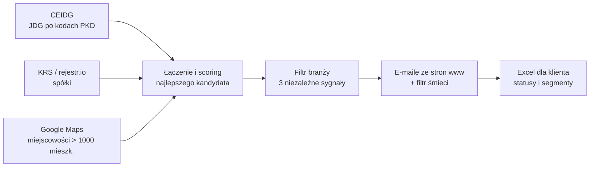

# Baza firm z całej Polski z kontaktem e-mail: case study

**Lead generation B2B: rejestry firm + Google Maps + strony www → gotowa baza do sprzedaży.**
Python · Playwright · openpyxl · CEIDG · KRS / rejestr.io · 2captcha

> Zlecenie z Useme (2026): klient chciał dostać **wszystkie firmy jubilerskie w Polsce** z danymi kontaktowymi, w tym z e-mailem.
> To repozytorium pokazuje, jak to zrobiłem, z kodem użytym w projekcie (bez danych klienta i bez kluczy API).

---

## Wynik w liczbach

| | |
|---|---|
| Firm w bazie wynikowej (JDG + spółki) | **ok. 6 700** |
| Przetworzonych wizytówek Google Maps | **5 774** |
| Przeskanowanych stron firmowych | **ok. 3 300** |
| Domen, z których pozyskano e-mail | **931** |
| Strony blokujące automat (403/404, bot-protection), oznaczone osobnym statusem | **392** |
| Skuteczność: strony www, które oddały e-mail | **ok. 70%** |
| Czas realizacji | **3-4 dni** |

## Problem

Żadne pojedyncze źródło nie ma wszystkiego:

- **Google Maps** ma telefon, stronę i kategorię, ale nie ma firm bez wizytówki i nie mówi, czy to JDG czy spółka.
- **CEIDG** (jednoosobowe działalności) i **KRS / rejestr.io** (spółki) mają wszystkie zarejestrowane firmy z NIP, ale część to firmy „na papierze” albo z PKD niepasującym do realnej działalności.
- **E-maile** w ogóle nie są w Maps, a strony firmowe są pełne śmieciowych adresów z szablonów (`mail@domain.com`), adresów agencji, które robiły stronę, i adresów technicznych.

## Jak to zrobiłem



1. **Zebranie firm z trzech źródeł.**
   JDG z CEIDG po kodach PKD branży (produkcja i hurt biżuterii, detal, naprawa zegarków), spółki z KRS / rejestr.io, a z Google Maps wyszukiwanie branży w każdej miejscowości w Polsce powyżej 1 000 mieszkańców. Dzięki temu w bazie są też firmy niewidoczne w Google i firmy widoczne w Google, ale zarejestrowane pod innym PKD.

2. **Łączenie rekordów**: [`rejestry_i_google/polacz_gmaps_z_ceidg.py`](rejestry_i_google/polacz_gmaps_z_ceidg.py).
   Kluczem jest ciąg „nazwa firmy + adres” użyty do wyszukania. Gdy Google zwraca kilka wyników, wybieram najlepszego kandydata punktowo:
   kategoria Google (jubilerska > zegarmistrzowska > ogólna), zgodność adresu (kod pocztowy, numer budynku, ulica), podobieństwo nazwy do nazwy z rejestru.

3. **Jedna baza JDG + spółki**: [`rejestry_i_google/zbuduj_baze_zbiorcza.py`](rejestry_i_google/zbuduj_baze_zbiorcza.py).
   Oba typy podmiotów w jednym arkuszu z kolumną „Typ podmiotu”, z weryfikacją, czy dane z rejestru zgadzają się z tym, co pokazuje Google.

4. **Filtr branży**: [`rejestry_i_google/filtruj_branze_jubilerska.py`](rejestry_i_google/filtruj_branze_jubilerska.py).
   Firma trafia do wyniku na podstawie trzech niezależnych sygnałów: kategorii z Google Maps (najmocniejszy dowód realnej działalności), kodu lub opisu PKD i słów w nazwie („jubiler”, „złotnik”, „biżuteria”…). Każda firma dostaje segment: jubiler / złotnik, sklep, producent, sprzedaż online, zegarmistrz. Odrzucone firmy zostają w osobnym arkuszu, żeby klient widział, co i dlaczego wypadło.

5. **E-maile**: [`wizytowki_i_maile/`](wizytowki_i_maile/).
   Dwa źródła: kontakty zebrane ze stron firmowych (eksport narzędzia scrapującego strony, łączony z bazą po adresie www) oraz własny [`email_finder.py`](wizytowki_i_maile/email_finder.py), który dla każdej domeny szuka adresu w wynikach Google. Najważniejsze reguły wyboru adresu, które wyszły w praktyce:
   - adres w domenie firmy ma pierwszeństwo przed adresami z innych domen,
   - odrzucane są adresy z szablonów (`mail@domain.com`, `jan.kowalski@email.pl`), adresy hostingów i agencji robiących strony, adresy techniczne oraz „adresy”, które są nazwami grafik (`logo@2x.png`),
   - agregatory (katalogi firm, portale z opiniami) nie są traktowane jako strona firmy.

6. **Captcha i blokady.**
   Scraper pracuje w jednej przeglądarce na trwałym profilu, spokojnym tempem. Gdy Google pokaże captchę, [`wspolne.py`](wizytowki_i_maile/wspolne.py) zleca ją do 2captcha (z tego samego IP), a gdy to się nie uda, czeka na ręczne rozwiązanie. Testy pokazały, że współdzielone proxy rezydencjalne pogarszają wynik (captcha przy każdym podejściu), dlatego proxy jest domyślnie wyłączone.

## Czego się nauczyłem

- **Jakość bazy decyduje o jej wartości, nie liczba rekordów.** Filtr fałszywych adresów odsiał kilkadziesiąt kontaktów, które wyglądały na prawdziwe.
- **Informacja „dlaczego brak” jest równie ważna jak dane.** Odrzucone firmy i strony blokujące automat są oznaczone, więc klient wie, co warto sprawdzić ręcznie.
- **Rejestr + Google razem dają pełny obraz.** Same rejestry mają firmy-widma, samo Google gubi firmy bez wizytówki.

## Struktura

```
rejestry_i_google/     łączenie CEIDG, KRS / rejestr.io i Google Maps, filtr branży
wizytowki_i_maile/     scraper wizytówek Google (Playwright) + wyszukiwanie e-maili + obsługa captchy
data/                  miejsce na pliki wejściowe (puste: dane klienta nie są publikowane)
```

## Uruchomienie

```bash
pip install -r requirements.txt
playwright install chromium

# opcjonalnie: klucz 2captcha i proxy (bez nich captchę rozwiązuje się ręcznie)
export TWOCAPTCHA_API_KEY=...
export PROXY_HOST=host:port PROXY_LOGIN=... PROXY_PASSWORD=...

# wizytówki Google -> e-maile -> Excel, jednym poleceniem
python wizytowki_i_maile/uruchom_wszystko.py linki.txt
```

Skrypty z `rejestry_i_google/` czytają eksporty z rejestrów i narzędzi scrapujących z katalogu `data/` (lub `DATA_DIR`).

## Uwagi

- Repozytorium nie zawiera danych klienta ani danych firm, tylko kod.
- Projekt dotyczy danych firmowych (B2B) z publicznych rejestrów i wizytówek. Przy wysyłce ofert do JDG trzeba pamiętać o obowiązku informacyjnym z RODO (art. 14).
- Kod powstał z pomocą asystentów AI (Claude Code); architektura, reguły jakości danych i testy na prawdziwych danych są moje.

---

**Autor:** Patryk Olech: AI Automation & GTM Engineer · [CV i inne projekty](https://github.com/patrykolech)
